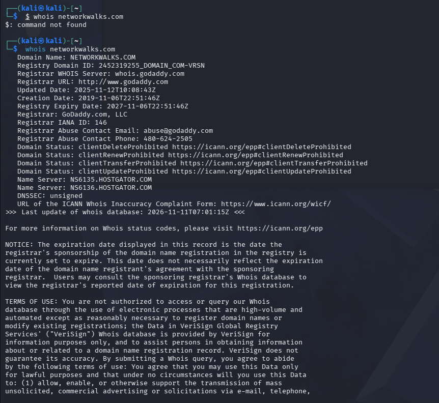
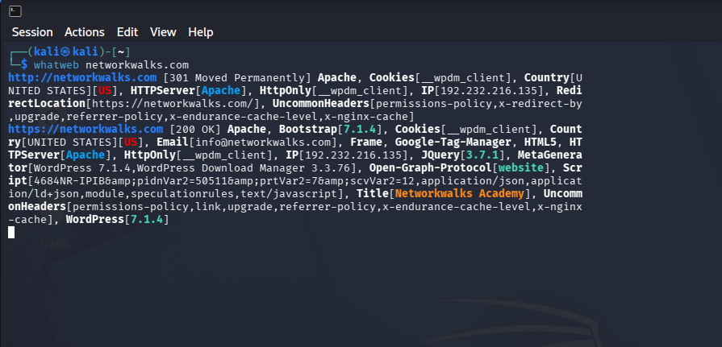
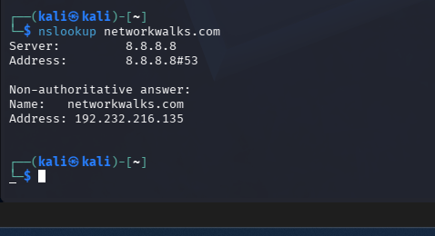
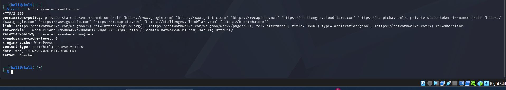
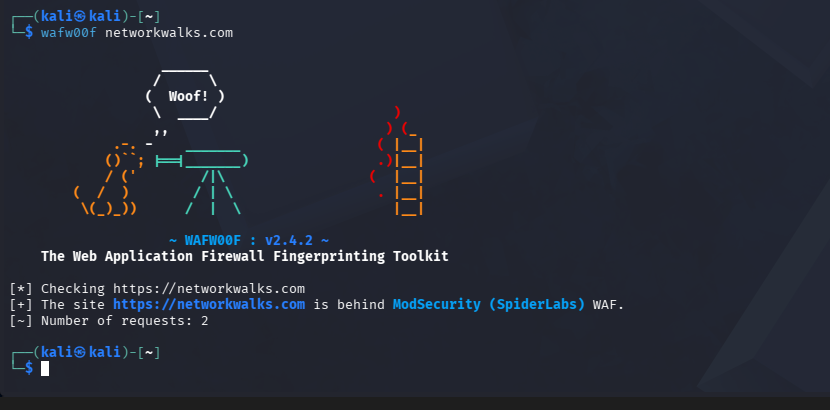
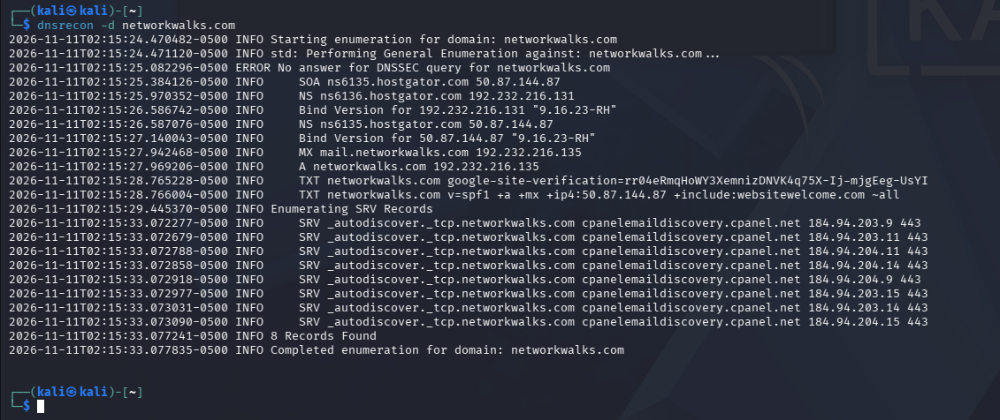
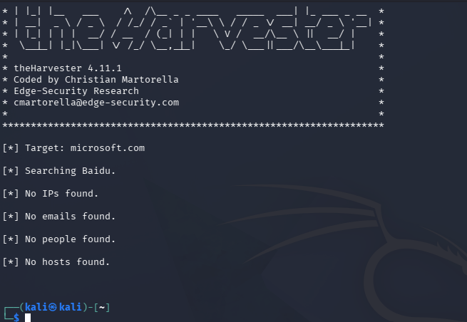
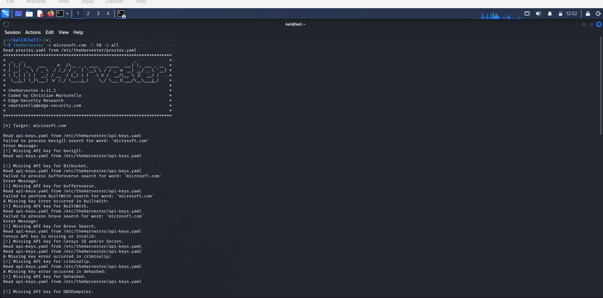

# Footprinting, Reconnaissance & Network Scanning

**Author:** Mayuresh Sangale  
**Program:** Cybersecurity Professional B084 - Networkwalks  
**Week:** 02  
**Report:** W2-PM-FINAL

> **Lab-use note:** The activities documented here were performed for educational purposes against the lab-designated target and local network. Only test systems for which you have explicit authorization.

## Module 1 - Footprinting & Reconnaissance

**Target domain:** `networkwalks.com`  
**Tools:** WHOIS, WhatWeb, NSLookup, cURL, WAFW00F, DNSRecon

### Task 1 - WHOIS

```bash
whois networkwalks.com
```

**Purpose:** Retrieve public domain-registration information, including registrar, registration dates and name servers.

| Field | Observed value |
|---|---|
| Domain | `NETWORKWALKS.COM` |
| Registrar | GoDaddy.com, LLC |
| Creation date | 2019-11-06 |
| Expiry date | 2027-11-06 |
| Name servers | NS6135.HOSTGATOR.COM, NS6136.HOSTGATOR.COM |
| DNSSEC | Unsigned |



### Task 2 - WhatWeb

```bash
whatweb networkwalks.com
```

**Purpose:** Identify technologies and services exposed by the target website.

| Item | Observed value |
|---|---|
| Web server | Apache |
| IP address | `192.232.216.135` |
| CMS | WordPress |
| WordPress Download Manager | 3.3.76 |
| jQuery | 3.7.1 |
| Bootstrap | 7.1.4 (as reported by WhatWeb) |
| Other | Google Tag Manager, HTML5 |
| Page title | Networkwalks Academy |
| Redirect | HTTP to HTTPS (301) |



### Task 3 - NSLookup

```bash
nslookup networkwalks.com
```

**Purpose:** Resolve the domain name to its IP address.

| Item | Observed value |
|---|---|
| DNS server | `8.8.8.8` |
| Resolved IP | `192.232.216.135` |



### Task 4 - HTTP response headers with cURL

```bash
curl -I https://networkwalks.com
```

**Purpose:** Inspect the HTTP response headers returned by the target.

- Response shown: `HTTP/2 200` for the HTTPS request.
- Server: Apache.
- `X-nginx-cache: WordPress`.
- Content type: `text/html; charset=UTF-8`.
- WordPress-related cookie: `__wpdm_client` (HttpOnly).
- Referrer policy: `no-referrer-when-downgrade`.
- Permissions-Policy header is present.



### Task 5 - Web Application Firewall detection

```bash
wafw00f networkwalks.com
```

**Purpose:** Identify whether a web application firewall is detected.

**Result:** WAFW00F reported that `https://networkwalks.com` is behind **ModSecurity (SpiderLabs)**. The tool reported 2 requests.



### Task 6 - DNS enumeration

```bash
dnsrecon -d networkwalks.com
```

**Purpose:** Enumerate publicly available DNS records.

| Record | Observed value |
|---|---|
| NS | `ns6135.hostgator.com` (50.87.144.87), `ns6136.hostgator.com` (192.232.216.131) |
| MX | `mail.networkwalks.com` (192.232.216.135) |
| A | `networkwalks.com` -> `192.232.216.135` |
| TXT | Google site verification and SPF record (`v=spf1 +a +mx ...`) |
| SRV | `_autodiscover._tcp` -> `cpanelemaildiscovery.cpanel.net` (8 records) |

**Observation:** The SOA lookup timed out and no DNSSEC answer was returned. DNSRecon reported 8 records in the SRV enumeration.



## Module 4 - Footprinting & Reconnaissance with theHarvester

**Target domain:** `microsoft.com`  
**Tool:** theHarvester 4.11.1 (Kali Linux)

`theHarvester` is an OSINT tool that gathers publicly available information such as email addresses, subdomains, hosts and names from supported public data sources.

### Task 1 - Search using Baidu

```bash
theHarvester -d microsoft.com -l 1000 -b baidu
```

**Purpose:** Search Baidu for public information associated with the target, with a result limit of 1000.

| Item | Result |
|---|---|
| Target | `microsoft.com` |
| Source | Baidu |
| IPs found | None |
| Emails found | None |
| People found | None |
| Hosts/subdomains found | None |

**Observation:** Baidu returned no data for this domain at the time of the scan. Results from third-party sources can vary over time.



### Task 2 - Search using all supported sources

```bash
theHarvester -d microsoft.com -l 50 -b all
```

**Purpose:** Query all supported sources with a result limit of 50.

The output showed that theHarvester read its API-key configuration file at `/etc/theHarvester/api-keys.yaml`. Several sources could not be queried because API keys were not configured.

| Source | Status shown |
|---|---|
| BeVigil | Missing API key |
| Bitbucket | Missing API key |
| BufferOverrun | Missing API key |
| BuiltWith | Missing API key |
| Brave Search | Missing API key |
| Censys | Missing API key (ID and/or Secret) |
| CriminalIP | Missing API key |
| Dehashed | Missing API key |
| DNSDumpster | Missing API key |

**Observation:** Sources requiring credentials return no data until their API keys are configured in the relevant configuration file.



## Module 5 — Network Scanning with Zenmap

### Objective
Use Zenmap, the official GUI for Nmap, to discover live hosts on a local network, identify their IP and MAC addresses, and visualize the network topology.

**Tool used:** Zenmap / Nmap 7.993 on Windows

---

### Task 1 — Download & Install Zenmap on Windows

**Purpose:** Install Nmap with its Zenmap GUI from the official website (https://nmap.org/download.html).

**Result:** Zenmap is installed and running on Windows. Zenmap opens with the default Intense scan profile (`nmap -T4 -A -v`).


---

### Task 2 — Find Local IP Address & LAN Subnet

**Command**
```cmd
ipconfig
```


**Purpose:** Identify the PC's local IP address and subnet.

**Results (Wi-Fi adapter)**

| Item | Value |
|---|---|
| IPv4 Address | 192.168.29.245 |
| Subnet Mask | 255.255.255.0 (/24) |
| Default Gateway | 192.168.29.1 |
| LAN Subnet | 192.168.29.0/24 |

The Ethernet adapter (192.168.56.1/24) is a virtual adapter, likely from VirtualBox. It has no default gateway, so it is not the LAN used for the scan.

---

### Task 3 — Find Live Hosts in the Subnet

**Command**
```bash
nmap -sn 192.168.29.0/24
```


**Purpose:** Run a Ping scan (host discovery only, no port scan) in Zenmap against the LAN subnet found in Task 2.

**Result:** Nmap scanned 256 IP addresses and found **5 hosts up** in 4.95 seconds.

---

### Task 4 — How many hosts are live?

**Answer:** 5 hosts are live, including my own PC.

---

### Task 5 — IP addresses of the live hosts

| # | IP Address | Notes |
|---|---|---|
| 1 | 192.168.29.1 | Default gateway (router, shown as `reliance.reliance`), latency 0.010s |
| 2 | 192.168.29.18 | Latency 0.13s |
| 3 | 192.168.29.177 | Latency 0.37s |
| 4 | 192.168.29.215 | Latency 0.27s |
| 5 | 192.168.29.245 | My own PC (confirmed by ipconfig) |

---

### Task 6 — MAC addresses of the live hosts

| IP Address | MAC Address | Vendor (per Nmap) |
|---|---|---|
| 192.168.29.1 | 9C:D4:A6:8A:86:61 | Servercom (India) Private Limited |
| 192.168.29.18 | 04:C8:07:20:56:2A | Xiaomi Communications |
| 192.168.29.177 | 10:76:36:0E:62:C8 | Earda Technologies |
| 192.168.29.215 | 0A:B8:A5:73:6C:87 | Unknown |
| 192.168.29.245 | Not shown (local host) | Use `ipconfig /all` to find it |

---

### Task 7 — Network Topology

**Purpose:** View the scan results as a topology graph and save it as a PDF.

**Steps**
1. Opened the Topology tab in Zenmap.
2. Turned on the Legend.
3. Clicked Save Graphic and chose PDF.


**Result:** The topology shows localhost at the center, connected to all five live hosts (192.168.29.1, .18, .177, .215 and .245).
## Skills Practiced

- Domain footprinting and WHOIS analysis
- Web-technology fingerprinting
- DNS resolution and DNS-record enumeration
- HTTP response-header inspection
- Web application firewall detection
- Passive reconnaissance using theHarvester
- Understanding API-key requirements for OSINT data sources
- Reading Windows IP configuration and identifying a local subnet
The detailed penetration-testing report covering the modules above is available here:\
https://drive.google.com/file/d/1hyaDICx_7dwaPaht7FWYWTx757P4GqM7/view?usp=sharing \
 linked in profile:-\
 www.linkedin.com/in/mayuresh-sangle-586879268 

## Conclusion

The exercises demonstrated how command-line tools in Kali Linux can collect and interpret public domain, web-technology, HTTP-header, WAF and DNS information. theHarvester demonstrated how OSINT results depend on the selected data source and API-key configuration. The Windows network-configuration evidence identified the local Wi-Fi IPv4 address, subnet mask and default gateway. These techniques are useful for understanding an organization's externally visible footprint and documenting a lab reconnaissance workflow.

---

**Author:** Mayuresh Sangale  
**Cybersecurity Professional B084**  
**Program:** Cybersecurity program at Networkwalks | **Week:** 02 | **Repository:** GitHub
